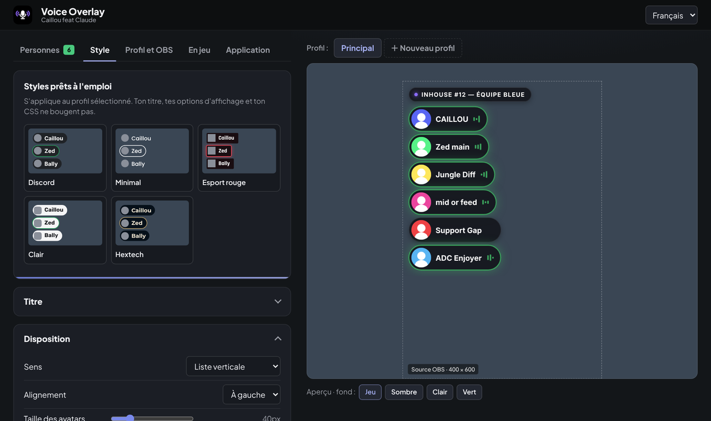

# VOICE OVERLAY - CAILLOU FEAT CLAUDE

🇫🇷 [Version française](README.md)

An OBS overlay that shows who is in **your** Discord voice channel, and follows you on its own when you switch channels.

- Shows who is speaking, muted or deafened
- Switches channels with you, and hides when you're in none
- Rename, reorder or hide people
- Fully customizable look, with ready-made styles
- League of Legends roles shown and sorted (Top, Jgl, Mid, ADC, Sup)
- Several profiles at once, one per OBS scene
- In French and English

## Install (Windows)

1. Download the latest `Voice-Overlay-<version>.exe` from [Releases](../../releases/latest).
2. Open the Discord app (not the website), then run the `.exe`.
   If Windows shows "Windows protected your PC", click **More info**, then **Run anyway**.
3. Follow the assistant (about 3 minutes, only once), then click **Authorize** in Discord.

The app then runs in the background, with an icon next to the clock. It updates in one click.

## In OBS

Add a **Browser** source with the link shown in the settings ("Profile & OBS" tab), 400 × 600 to start. The background is transparent.

## DPM inhouses

With the Chrome extension in the [`extension`](extension) folder, the overlay gets each player's role and team from your [inhouse.dpm.lol](https://inhouse.dpm.lol) lobby, and links each Discord account to its Riot ID on its own.

Detection isn't perfect: if a role is wrong, pick the right one by hand in the "People" tab.

## In-game overlay

The "In game" tab shows your voice channel on top of League during your games. It's hidden from your stream. League must be in "Borderless" or "Windowed" mode. Ctrl+Shift+O to move it.

## Good to know

- Everything stays on your PC. The app only connects to Discord and GitHub (for updates).
- It uses a Discord feature that is still in beta: if Discord changes it, the overlay may stop working.
- If something goes wrong: "App" tab → **Copy diagnostics**, and send it with your question.

## Credits

Made by Caillou, with Claude. Rust version by tbrowang. [MIT license](LICENSE) · [Third-party licenses](LICENCES-TIERS.txt)
