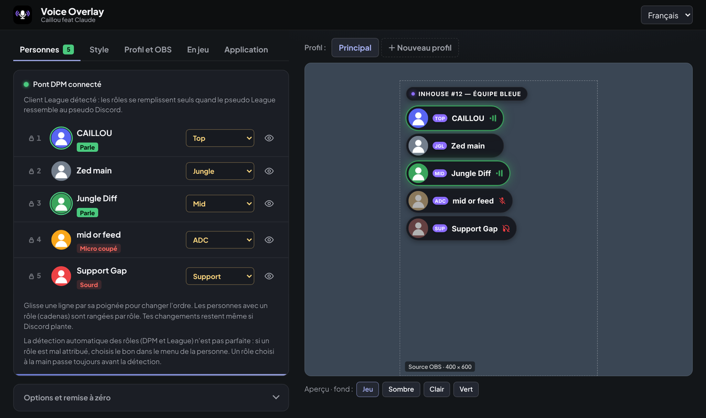

# VOICE OVERLAY - CAILLOU FEAT CLAUDE

🇬🇧 **English version: [README.en.md](README.en.md)**

Overlay OBS qui affiche les personnes présentes dans **ton** salon vocal Discord, et qui te suit tout seul quand tu changes de salon. Aucun salon à choisir à la main, rien à installer sur le serveur.



- Montre qui parle, qui est mute ou sourd, avec les décorations d'avatar Discord
- Suit le vocal où tu te trouves, et n'affiche rien quand tu n'es dans aucun
- Renommer, réordonner ou masquer des personnes à la volée, sans tout perdre si Discord plante
- Page de réglages en direct : disposition, couleurs, 12 polices fournies (ou importe la tienne), CSS personnalisé
- Rôles League of Legends (Top, Jungle, Mid, ADC, Support) détectés depuis le client League quand le pseudo ressemble, ou choisis à la main, avec tri automatique
- Inhouses [DPM](https://inhouse.dpm.lol) : avec l'extension Chrome fournie (dossier `extension`), rôle et équipe de chaque joueur, et lien Discord ↔ League appris tout seul quand les pastilles passent au vert
- Plusieurs profils d'overlay utilisables en même temps (par exemple vertical en jeu, horizontal ailleurs), chacun avec son lien OBS
- Exporte ton style dans un fichier pour le partager
- En français et en anglais

> **À savoir :** l'appli dépend d'une fonction de Discord (RPC local) encore classée en bêta privée. Si Discord la modifie ou la ferme, l'overlay cessera de fonctionner. Chaque utilisateur doit aussi créer sa propre « application » Discord gratuite (l'appli te guide, environ 2 minutes).

## Installation (Windows)

1. Télécharge `Voice-Overlay-<version>.exe` (par exemple `Voice-Overlay-1.2.0.exe`) depuis la page Releases et mets-le où tu veux (Téléchargements, Bureau…). Il ne crée aucun fichier à côté de lui.
2. Ouvre Discord **desktop** (pas la version navigateur), puis lance le `.exe`.
   - Windows peut afficher « Windows a protégé votre ordinateur » : clique sur **Informations complémentaires**, puis **Exécuter quand même**. C'est normal pour une appli non signée.
3. Un assistant s'ouvre dans ton navigateur et te guide en 4 étapes pour relier l'overlay à Discord.
4. À la fin, Discord ouvre une fenêtre : clique sur **Autoriser**.

L'appli tourne ensuite en arrière-plan. Son icône est à côté de l'horloge : clic gauche pour les réglages, clic droit pour quitter.

## Dans OBS

Ajoute une **Source → Navigateur** avec le lien du profil, affiché dans les réglages (par exemple `http://localhost:47474/?profile=principal`). Largeur 400, hauteur 600 pour commencer. Le fond est transparent.

Chaque profil a son propre lien : crée-en un par scène et ajoute chaque lien dans la scène qui va avec. Ils fonctionnent tous en même temps.

Pour des ajustements rapides, des options dans l'URL passent au-dessus des réglages du profil :
`?title` `?noTitle` `?hideSelf` `?speakingOnly` `?noName` `?size=48` `?align=right` `?layout=row`

## Vie privée

- Tout tourne sur ton PC. Tes réglages et tes codes Discord sont enregistrés dans `%APPDATA%\VoiceOverlayCaillou` (bouton « Ouvrir » dans la partie Application des réglages). Ne partage jamais `config.json` ni `token.json` et ne les montre pas en stream.
- Les seules connexions extérieures vont vers Discord (connexion, avatars) et vers GitHub, pour vérifier s'il existe une version plus récente.

## En cas de souci

Le fichier `voice-overlay.log`, dans le dossier des données (`%APPDATA%\VoiceOverlayCaillou`), dit ce qui s'est passé.

Pour tout effacer et repartir de zéro : quitte l'appli et supprime ce dossier.

## Développement

Rien à installer pour le lancer, il faut seulement Node.js 20 ou plus :

```
node server.js --open     # mode normal (Discord desktop ouvert)
node server.js --demo     # faux membres, sans Discord
```

| Fichier | Rôle |
|---|---|
| `server.js` | Connexion à Discord (RPC local), serveur local, réglages |
| `overlay.html` | La page affichée dans OBS |
| `settings.html` | La page de réglages et l'assistant |
| `webfonts/` | Polices fournies (licence OFL) |
| `build/` | Fabrication du `.exe` (`cd build && npm install && node build.js`) |

### Version Rust (`rust/`)

Le même programme, réécrit en Rust : un `.exe` d'environ 3 Mo au lieu d'embarquer Node.js, une vraie icône près de l'horloge (plus de script PowerShell), et le Client Secret et le jeton Discord rangés dans le Gestionnaire d'identifiants de Windows au lieu de `config.json` et `token.json` (déplacés automatiquement au premier lancement). Les pages `overlay.html` et `settings.html` sont les mêmes, embarquées dans le `.exe`, et les adresses (`/events`, `/api/...`) n'ont pas changé : l'extension Chrome marche telle quelle.

```
cd rust
cargo run -- --demo --port=47474   # faux membres, sans Discord
cargo test                         # tests (ressemblance des pseudos, liens DPM, Discord…)
cargo build --release              # .exe dans rust/target/release (sous Windows)
```

Depuis macOS ou Linux : `rustup target add x86_64-pc-windows-msvc`, `cargo install cargo-xwin`, installer `mingw-w64` (pour l'icône), puis `cargo xwin build --release --target x86_64-pc-windows-msvc`. N'utilise pas la cible `-gnu` : le `.exe` aurait besoin de `WebView2Loader.dll` à côté de lui. Le workflow `.github/workflows/rust.yml` fabrique le `.exe` sous Windows et le joint à la release pour chaque tag `v*`.

Ce que la version Rust ajoute dans la page de réglages :

- **Une vraie fenêtre pour les réglages** au lieu d'un onglet du navigateur : même page, affichée par le moteur web de Windows (WebView2), avec l'icône de l'appli. La fermer libère sa mémoire, l'overlay continue de tourner ; l'icône près de l'horloge la rouvre. Les liens externes s'ouvrent dans ton navigateur, et la page reste accessible à `http://localhost:47474/settings`. Sans WebView2, les réglages s'ouvrent dans le navigateur comme avant.
- **Mise à jour en un clic** : quand une nouvelle version sort, le bouton « Installer maintenant » la télécharge depuis la release GitHub, vérifie son empreinte SHA-256 (donnée par GitHub), remplace le `.exe` et relance l'appli. Si quelque chose ne va pas, l'ancienne version reste en place.
- **Styles prêts à l'emploi**, avec un petit aperçu et un bouton pour annuler.
- **Glisser-déposer** pour réordonner les personnes (souris ou doigt ; flèches du clavier aussi).
- **Ajouter à OBS automatiquement**, grâce au serveur WebSocket intégré à OBS 28 et plus : la source « Navigateur » est créée (ou mise à jour) dans la scène choisie.
- **Copier le diagnostic** : un rapport à envoyer en cas de souci (versions, états, détection League/DPM, fin du journal ; aucun mot de passe ni code Discord).

#### Signer le `.exe` (supprime l'avertissement « Windows a protégé votre PC »)

1. Demande une offre gratuite pour projet open source sur [signpath.org](https://signpath.org) (le dépôt doit être public).
2. Dans SignPath, crée un projet `voice-overlay` lié à ce dépôt GitHub, avec une règle de signature `release-signing`.
3. Sur GitHub, dans Settings → Secrets and variables → Actions : ajoute la variable `SIGNPATH_ORGANIZATION_ID` et le secret `SIGNPATH_API_TOKEN`.

Ensuite, chaque tag `v*` publie un `.exe` signé. Tant que ce n'est pas configuré, le workflow publie le `.exe` sans signature, comme avant.

Options utiles : `--port=N` (ou `VO_PORT`), `--silent`, `VO_DATA_DIR` (autre dossier de données), `VO_ASSETS_DIR=..` (lit les pages sur le disque, sans recompiler), `VO_NO_KEYRING=1` (secrets dans des fichiers), `VO_DEBUG=1` (journal détaillé). Dans `config.json`, `extensionIds` limite le pont DPM à certaines extensions. L'extension appelle le port 47474 : si tu le changes, modifie aussi `extension/background.js`.

## Crédits

Fait par Caillou, construit avec Claude. Publié sous [licence MIT](LICENSE). Embarque Node.js et des polices libres : voir [LICENCES-TIERS.txt](LICENCES-TIERS.txt).
